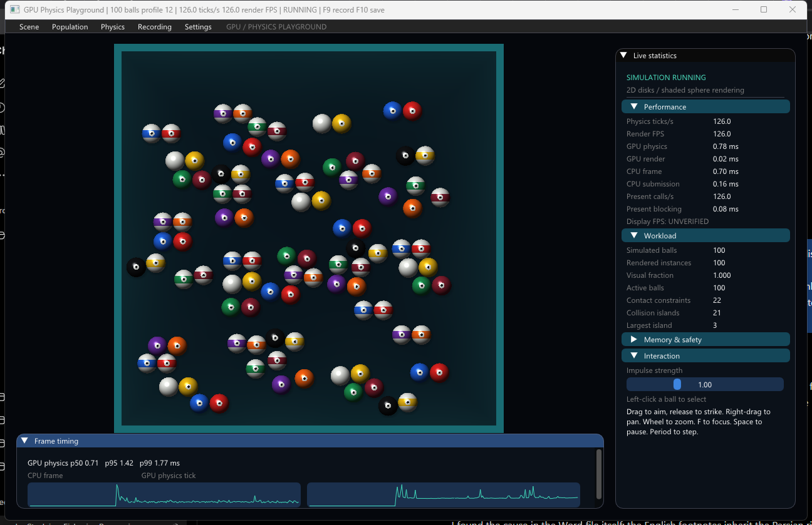

# GPU Physics Playground

A playable Windows x64 GPU physics sandbox using Zig, C, HLSL and D3D12. Real 2D disk collisions are rendered as shaded spheres in one continuous arena.

Download [GPUPhysicsPlayground-Windows-x64.zip](dist/GPUPhysicsPlayground-Windows-x64.zip), extract **everything** into a writable folder and run **Launch.bat** or **GPUPhysicsPlayground.exe**. No development tools are required to run. Requires Windows 10/11 x64, D3D12 shader double precision and sufficient current DXGI memory budget. The CPU target is baseline x86-64.



Left-click selects; drag aims and release applies a bounded impulse at the next global physics tick. Right-drag pans, wheel zooms, F focuses, Space pauses, Period steps, R resets, Home fits the arena and Esc deselects then closes. Adjust shot strength in the statistics panel. H hides the interface. Population presets provide 100/1K previews and genuine 10K/100K/1M simulations. Original independent-table presets remain under **Scene → Scientific Benchmarks**.

The Dear ImGui interface has scene/population/physics/recording/settings menus, collapsible workload statistics and rolling timing charts. F9 starts/stops recording, F10 asynchronously saves, and F12 captures the actual backbuffer. Results are written beside the executable in unique `results/session-*` directories. [Usage, scene parameters and limits](PLAYGROUND_README.txt) describe the CSV/JSON data and controls.

## Measured execution

The packaged executable was extracted into a separate directory containing spaces, launched from an unrelated working directory with only Windows System32 on PATH, and exercised through native controls. These are short automated workload runs on an RTX 4070 Ti SUPER, not a promise of sustained frame rate or a physical display measurement. GPU physics timing includes the complete existing physics pipeline.

| Real balls | Actual ticks | Maximum contact constraints | GPU physics p50 / p95 / p99 ms | Peak observed local MiB |
|---:|---:|---:|---:|---:|
| 100 | 294 | 52 | 0.73 / 1.37 / 1.77 | 30.2 |
| 1,000 | 139 | 514 | 1.15 / 1.99 / 2.29 | 33.3 |
| 10,000 | 138 | 5,096 | 1.81 / 2.68 / 3.06 | 54.9 |
| 100,000 | 128 | 49,842 | 7.02 / 11.00 / 12.53 | 285.7 |
| 1,000,000 | 56 | 508,565 | 40.02 / 47.38 / 61.11 | 2501.9 |

All submitted physics ticks passed existing GPU coverage, validation and all-N publication checks. Exact independently calculated tick-2 contact counts are 50, 500, 5,000, 49,320 and 500,000. A separate mouse-driven 100-ball test verifies actual selection, impulse propagation, external momentum, every position update and all 4,950 non-overlap pairs. It also verifies that paused statistics retain the latest completed tick. Nine original scientific population/profile combinations pass their independent full-coverage physics oracle, and the evolving generational lifecycle test passes. GPU validation passes at 1/2/3 frames in flight; stale command generation/epoch/tick tests reject with source rollback.

See [verification results](PLAYGROUND_VERIFICATION.json), [raw example recordings](examples/playground), [aiming](docs/screenshots/aiming.png), [collision close-up](docs/screenshots/collision-after-impulse.png), [expanded statistics](docs/screenshots/statistics-expanded.png), and [1M scene](docs/screenshots/million-balls.png). Screenshots are actual running-executable captures.

## Build and reproduce

Install Zig 0.15.2, Python 3 and a Windows SDK with D3D12 headers/UCRT/DXC. Scripts discover SDK paths; RTK and Visual Studio are not required. Pillow is needed only by the screenshot automation tests.

```powershell
python build_playground.py --tests
.\zig-out\bin\playground_gpu_tests.exe
python test_playground_interaction.py
python package_playground.py
python test_playground_app.py
```

To run the original independent scientific oracle and lifecycle checks:

```powershell
python build_viewer.py --host-only --reference-cli
python build_viewer.py --host-only --lifecycle
foreach ($n in 10000,100000,1000000) {
  foreach ($profile in 9,10,11) {
    .\zig-out\bin\viewer.exe --n $n --profile $profile --steps 24 --quiet --out "scientific-$n-$profile.json"
  }
}
New-Item -ItemType Directory -Force lifecycle-results
.\zig-out\bin\g4_lifecycle.exe lifecycle-results
python test_playground_regression.py
```

`package_playground.py` audits PE imports and writes binary/dependency SHA256 plus source/vendor hashes inside the ZIP. Dear ImGui v1.90.9 is pinned and statically linked; its MIT license is included.

## Limits and preserved gates

The fixed global timestep remains 1/128. The projected solver and original scientific scene definitions are unchanged. There are no initial playground overlaps; world dimensions scale with population, approaching 34.9% initial area occupancy. Contacts are inelastic and frictionless, so motion dissipates; the user can add energy with real impulses.

Contact/candidate reservations are checked 12*N/16*N allocations, not universal topology bounds. Overload or nonconvergence explicitly rejects publication. The existing bounded large-island fallback remains; no giant connected-island claim or G5 optimization is made. Scene changes require temporary old+new memory and preserve the active state if admission fails. Overview can sample 50K rendered instances while all N remain simulated; submitted rendering and active-body counts are separate.

**Display FPS and formal G4 GPU-02 remain UNVERIFIED.** Engine render FPS, physics TPS and Present rate are separately labeled. Strict immutable snapshot isolation is not newly proved; existing ordered validation/publication is preserved. Clustered scientific runs can differ in final hashes due to ordering in the original implementation too; deterministic initial hashes and independent invariants are retained. This app does not automatically approve G4 or start G5.

The earlier [benchmark-only ZIP](dist/GPUPhysicsBench-Windows-x64.zip) is preserved unchanged; [its documentation](BENCHMARK_README.md) explains those historical independent-table workloads. Frozen G0–G4 evidence remains preserved separately; it is not replaced by the playground results.
