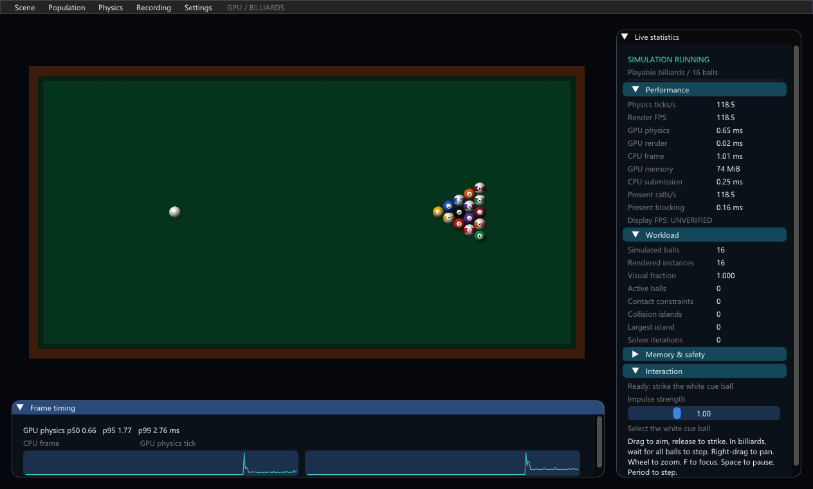

# GPU Physics Billiards

A standalone Windows D3D12 billiards demo built with Zig, C and HLSL. The default
is one table with exactly 16 stationary balls: one white cue ball and 15 numbered
object balls. GPU SoA storage, spatial indexing and the existing projected contact
solver advance the game at a fixed 1/128-second timestep.

The portable build is `dist/GPUPhysicsBilliards-Windows-x64.zip`: extract
**everything** into a writable folder and run **Launch.bat**. Requires
Windows 10/11 x64, D3D12 shader double precision and sufficient current GPU memory
budget. No development tools are needed to play.



Click the white cue ball, drag to aim, release to strike. The arrow shows shot
direction and delta velocity. Shots are blocked while balls move unless Settings
explicitly enables sandbox shots. Space pauses, Period steps one global tick,
R resets, Home fits the table and F focuses the cue. Right-drag pans; wheel zooms.
The panel shows engine FPS, physics TPS, GPU times, contacts, iterations and memory.

The corrected model uses new-impact restitution, cushion tangential friction,
sliding-to-rolling transition and bounded rolling resistance. Balls stop exactly.
It is a planar approximation without pockets, scoring, vertical motion or cue
elevation. Materials are chosen parameters rather than a calibrated commercial
table. See [usage and limits](BILLIARDS_README.txt) and the included
`BILLIARDS_PHYSICS_CORRECTION.md` for qualification and equations.

[Actual gameplay capture](docs/billiards/gameplay.mp4) shows aiming, a break,
collision transfer, a later rail shot and stopping. Images/video come from
fence-completed copies of the executable's actual D3D12 backbuffer. Video encoding
cadence is not displayed FPS. Formal GPU-02 remains **UNVERIFIED**; no G5 work or
new formal gate approval is claimed.

The analytical suite passes 10,000 stationary-rack GPU ticks, elastic/inelastic
and oblique impacts, rail materials, passive energy/rolling, persistent contacts,
sleep/wake and rejected-command rollback. Its complete run accepts 10,563 ticks
and publishes 169,008 object updates. Nine original scientific 10K/100K/1M
fixture combinations pass their independent full-coverage oracle. Seven matched
before/after process pairs per population find no >5% p95 regression in the tested
scientific mixed-contact profile; this is separate from game performance.

Scientific scenes remain under Scene and are labeled synthetic. Their original
seeds, drives and contact model remain. The previous continuous arena and its
[historical documentation](PLAYGROUND_HISTORY.md) are retained, along with both
older portable distributions.

Build with Zig 0.15.2, Python 3 and a Windows SDK providing DXC/D3D12/UCRT:

```powershell
python build_billiards.py --tests
python test_billiards_physics.py
.\zig-out\bin\playground_gpu_tests.exe
zig test tests.zig -O ReleaseSafe
python test_playground_regression.py
python test_billiards_gameplay.py
python package_billiards.py
python test_billiards_package.py
```

Pillow and ffmpeg are needed only for automated media capture. Run GPU tests
serially. CSV/JSON recordings use unique `results/session-*` directories.
The portable builder includes media, licenses, per-file hashes and source/build
hashes, plus reports and example results when available locally. Per the upload
scope, reports/raw measurements and the complete measured portable ZIP stay local;
the repository contains engine source, shaders, executable, tests and media.
