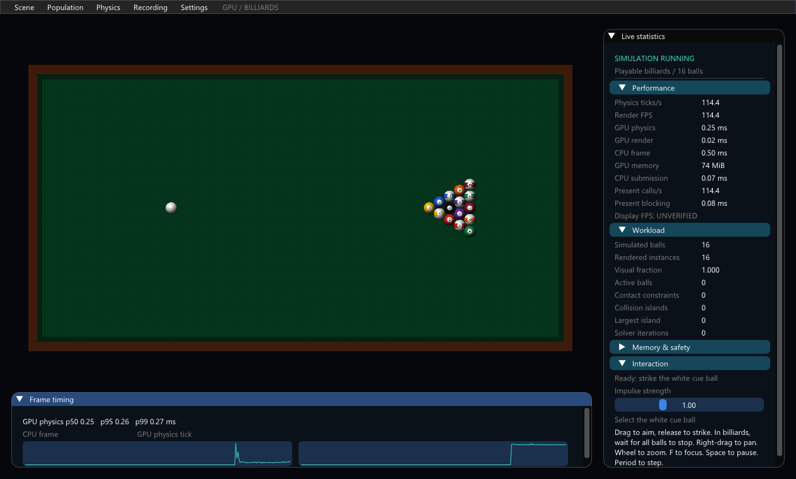

# GPU Physics Billiards

**Technical architecture and living gate record:** [docs/ENGINE_ARCHITECTURE.md](docs/ENGINE_ARCHITECTURE.md). Update it at each G0–G6 breakpoint or material architecture decision. Historical and local experimental results are labeled separately from released code.


## Fast headless development

```powershell
python dev_test.py                              # quick (default), usually seconds after first build
python dev_test.py affected                     # choose tests from current Git changes, including untracked code
python dev_test.py affected --files projected_solver.hlsl
python dev_test.py full                         # explicit full headless developer suite
```

Quick reuses the existing analytical GPU tests: 32 idle ticks, elastic/inelastic
and oblique collisions/rails, 200 rolling-energy ticks plus a sliding check, and
32 measured idle ticks after 8 warmup ticks. Numerical acceptance is unchanged.
Quick omits GBV; full retains the original 10,000-tick rack, break, rollback and
GBV cases, CPU contracts, command safety, 32-object storage/spatial/physics CLIs
and device-lifetime checks. Full can take minutes; it is a developer suite, not
gate qualification or a million-body campaign.

Affected maps shared runtime/storage/physics inputs to their headless checks;
solver changes omit idle; CPU test and CLI entry-point changes select those tests.
Rendering-only or documentation changes print SKIP rather than launching a viewer.
Explicit `--files` also restricts quick. Do not infer rendering correctness from SKIP.

Local include/import content hashes and tool/build options control incremental
builds; unchanged DXIL and executables are reused. The first run may build missing
CLIs and initialize `.dev-test-cache/`. Complete commands/logs and JSON results
are saved in `dev-test-results/<UTC>/`; failures return a nonzero exit code.
The overhead sample measures the **complete existing 16-object idle tick**, GPU
timestamps plus CPU recording/submission/blocking; it is informational on a shared
adapter, not a calibrated regression threshold or displayed FPS. Runs are serialized.
No screenshots, windows, packaging, or benchmark campaigns are part of these levels.

Workflow-only checks: `python -m unittest test_dev_workflow -v`.

A standalone Windows D3D12 billiards demo built with Zig, C and HLSL. The default
is one table with exactly 16 stationary balls: one white cue ball and 15 numbered
object balls. GPU SoA storage, spatial indexing and the existing projected contact
solver advance the game at a fixed 1/128-second timestep.

The current portable build is `dist/GPUPhysicsBilliards-Windows-x64-20261018-requalified.zip`: extract
**everything** into a writable folder and run **Launch.bat**. Requires
Windows 10/11 x64, D3D12 shader double precision and sufficient current GPU memory
budget. No development tools are needed to play.



Click the white cue ball, drag to aim, release to strike. The arrow shows shot
direction and delta velocity. Shots are blocked while balls move unless Settings
explicitly enables sandbox shots. Space pauses, Period steps one global tick,
R resets, Home fits the table and F focuses the cue. Right-drag pans; wheel zooms.
The panel shows engine FPS, physics TPS, GPU times, contacts, iterations and memory.

The corrected model uses new-impact restitution, cushion tangential friction,
sliding-to-rolling transition and bounded rolling resistance. Balls stop exactly.
It is a planar approximation without pockets, scoring, vertical motion or cue
elevation. Materials are chosen parameters rather than a calibrated commercial
table. See [usage and limits](BILLIARDS_README.txt) and the included
`BILLIARDS_PHYSICS_CORRECTION.md` for qualification and equations.

[Actual gameplay capture](docs/billiards/revalidation-20261018/gameplay.mp4) shows aiming, a break,
collision transfer, a later rail shot and stopping. Images/video come from
fence-completed copies of the executable's actual D3D12 backbuffer. Video encoding
cadence is not displayed FPS. Formal GPU-02 remains **UNVERIFIED**; this delivery claims no new formal G4/G5 approval.

The analytical suite passes 10,000 stationary-rack GPU ticks, elastic/inelastic
and oblique impacts, rail materials, passive energy/rolling, persistent contacts,
sleep/wake and rejected-command rollback. Its complete run accepts 10,598 ticks
and publishes 169,568 object updates. Nine original scientific 10K/100K/1M
fixture combinations pass their independent full-coverage oracle. Historical seven matched
before/after process pairs per population find no >5% p95 regression in the tested
scientific mixed-contact profile; this is separate from game performance.

Scientific scenes remain under Scene and are labeled synthetic. Their original
seeds, drives and contact model remain. The previous continuous arena and its
[historical documentation](PLAYGROUND_HISTORY.md) are retained, along with both
historical source variants. Earlier cleanup removed the old benchmark/playground ZIPs; the previous playable ZIP remains preserved.

Build with Zig 0.15.2, Python 3 and a Windows SDK providing DXC/D3D12/UCRT:

```powershell
python build_billiards.py --tests
python test_billiards_physics.py
.\zig-out\bin\playground_gpu_tests.exe
zig test tests.zig -O ReleaseSafe
python test_playground_regression.py
python test_billiards_gameplay.py
python package_billiards.py
python test_billiards_package.py --package <exact-versioned-zip>
```

Pillow and ffmpeg are needed only for automated media capture. Run GPU tests
serially. CSV/JSON recordings use unique `results/session-*` directories.
The portable builder includes media, licenses, per-file hashes and source/build
hashes, plus reports and example results when available locally. Per the upload
scope, reports/raw measurements and the complete measured portable ZIP stay local;
the repository contains engine source, shaders, executable, tests and media.

## Current playable delivery (2026-10-18)

`Launch.bat` now selects billiards; the synthetic benchmark uses `LaunchBenchmark.bat`.
`python build_billiards.py --tests` verifies source/tool/options/output hashes and reuses unchanged shaders/host code. Packaging rejects stale/unknown builds and preserves existing ZIPs. The current build passed 10,000 stationary ticks, complete analytical tests, actual cue/rail/stop/reset recording and scientific correctness at all three retained scales. See the dated correction report for exact current evidence and the limits of short tail-timing samples.
